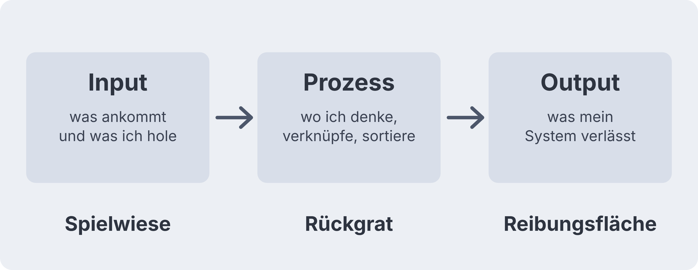
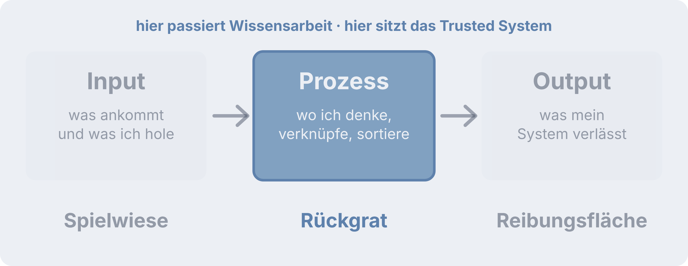
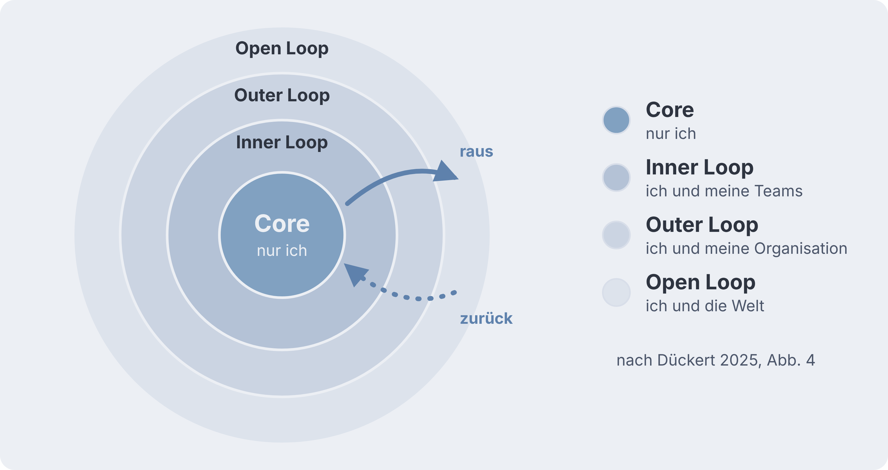

<!--
author:   Silvia Retzlaff, Gestaltung mit Claude
version:  0.1.0
language: de
mode:     Textbook
dark:     false
licence:  CC BY-SA 4.0
comment:  Persönliches Wissensmanagement: ein anderer Blick auf Zusammenarbeit – Workshop auf der collaborAID 2026 (Fr 13.11., Slot 2, online). Folien vorn, Tour zum Mitnehmen dahinter.

@style
/* ---------- Nord Color Scheme ----------
   Basis: https://www.nordtheme.com
   nord0 #2E3440  46,52,64    nord4 #D8DEE9 216,222,233
   nord1 #3B4252  59,66,82    nord5 #E5E9F0 229,233,240
   nord2 #434C5E  67,76,94    nord6 #ECEFF4 236,239,244
   nord3 #4C566A  76,86,106   nord9 #81A1C1 129,161,193
   LiaScript erwartet RGB-Tripel ohne rgb(), z. B. 46,52,64
------------------------------------------ */

/* Grundfarben umbiegen: "weiß" wird Nord-hell, "grau-dunkel" wird Nord-dunkel */
:root {
  --lia-white: 236,239,244;        /* nord6 */
  --lia-grey-lighter: 229,233,240; /* nord5 */
  --lia-grey-light: 216,222,233;   /* nord4 */
  --lia-grey: 129,161,193;         /* nord9 */
  --lia-anthracite: 59,66,82;      /* nord1 */
  --lia-grey-dark: 46,52,64;       /* nord0 */
}

/* Hell: Akzentfarbe = Nord-Dunkelgrau, Text = nord0, Hintergrund = nord6 */
html:root,
html:root[class*="lia-theme"] {
  --color-background: var(--lia-white);
  --color-text: var(--lia-grey-dark);
  --color-border: var(--lia-grey-light);
  --color-highlight: 76,86,106;        /* nord3 */
  --color-highlight-dark: 59,66,82;    /* nord1 */
  --color-highlight-menu: 236,239,244;   /* nord6 – aktiver Eintrag auf grauer Leiste */
}

/* Dunkel: Hintergrund nord0, Text nord6, Akzent heller (nord9), sonst unlesbar */
html:root.lia-variant-dark,
html:root.lia-variant-dark[class*="lia-theme"] {
  --color-background: var(--lia-grey-dark);
  --color-text: var(--lia-white);
  --color-border: var(--lia-anthracite);
  --color-highlight: 76,86,106;      /* nord3 */
  --color-highlight-dark: 94,129,172;  /* nord10 */
  --color-highlight-menu: 236,239,244;   /* nord6 – auf der blauen Leiste (nord9) */
}

/* etwas ruhigere Tabellen und Zitate */
blockquote { border-left-width: 4px; }
@end
-->

# Persönliches Wissensmanagement

<!-- style="font-size: 1.4em; font-weight: 300; margin: 1.5em 0 2em" -->
ein anderer Blick auf Zusammenarbeit

**Silvia Retzlaff** · collaborAID 2026 · 13. November 2026

> Für alle, die mit anderen zusammenarbeiten und dabei ihre eigene Arbeitsweise behalten wollen.

<!-- style="font-size: 0.85em; opacity: 0.7; margin-top: 3em" -->
Keine Tools, kein Setup. Vier Praktiken und ein Fragenset zum Mitnehmen.

---

## Welches Tier passt zu deinem Arbeitsalltag?

> Zoom-Umfrage – bitte abstimmen.

- 🐿️ **Eichhörnchen** – sammelt alles, findet die Hälfte wieder
- 🦫 **Biber** – baut erst den Damm, dann darf etwas rein
- 🐜 **Ameise** – übergibt sauber, hinterlässt eine Spur
- 🐙 **Oktopus** – acht Arme, acht Tools, alles gleichzeitig

<!-- style="font-size: 0.85em; opacity: 0.7; margin-top: 2em" -->
Nicht du bist das Tier: dein Arbeitsalltag könnte es aber sein.

---

## Jedes Tier hat ein Rückgrat und eine Reibungsfläche

| | Rückgrat: **was seine Welt zusammenhält** | Reibungsfläche: **was sich falsch anfühlt** |
|---|---|---|
| 🐿️ **Eichhörnchen** · Input | das gute Gefühl, dass alles irgendwo liegt | wenn jemand fragt „wo?“ und das Zukunfts-ICH es auch nicht mehr weiß |
| 🦫 **Biber** · Verarbeitung | die eigene Ordnung | wenn das Team eine andere Ordnung hat und umbenannt werden soll |
| 🐜 **Ameise** · Output | die Spur, der andere folgen können | wenn es keine Übergabe gibt, sondern gemeinsames Werk |
| 🐙 **Oktopus** · Orte | Beweglichkeit; es kann überall mitspielen | wenn keiner mehr weiß, wo die gültige Fassung liegt |

<!-- style="font-size: 1.4em; opacity: 0.7; margin-top: 1.5em" -->
Egal welches Tier: Du hast ein System auch wenn du es nicht so nennst. 

---

# Teil 1 · Die eigene Praxis erkunden

<!-- style="font-size: 1.4em; font-weight: 300; margin: 1.5em 0 2em" -->
das eigene System verstehen

---
## Vom Trusted System zum System of Trust

> Ein **Trusted System** ist ein zuverlässiges System außerhalb des eigenen Kopfes, in dem nichts verloren geht.
> Ein **System of Trust** erweitert die Idee auf die Zusammenarbeit: Was ich übergeben habe, muss ich nicht mehr im Blick behalten.

<!-- style="font-size: 0.85em; opacity: 0.7" -->
Jöran Muuß-Merholz, Digitale Zusammenarbeit 4.0, Bd. 1, Prinzip 7

<!-- style="font-size: 1.3em; font-weight: 300; margin-top: 2em" -->
Dieser Workshop arbeitet an dem, was mit *Systems of Trust* vorausgesetzt wird: **deinem eigenen System** ... und das ist mehr als ein Speicher für Aufgaben UND das von Team-Prozessen geprägt ist, aber nicht nur.

---

## Input · Prozess · Output

<!-- style="font-size: 0.85em; opacity: 0.7" -->
Dreischritt: Dückert 2025; 

<!-- style="font-size: 0.85em; opacity: 0.7" -->
Seek, Sense, Share: Jarche 2014; 

<!-- style="font-size: 0.85em; opacity: 0.7" -->
Spielwiese, Rückgrat, Reibungsfläche: Retzlaff, Arnold, Siegel & Lohner 2026

---

## Input: Push und Pull

| | **gefragt / bewusst** | **ungefragt / unbewusst** |
|---|---|---|
| **Push** kommt auf mich zu | abonnierte Kanäle, Newsletter, Feeds: die kuratierte Spielwiese | alles, was Team, Organisation und Welt mir hinwerfen |
| **Pull** ich hole es mir | Recherche: erst im eigenen System, dann draußen | Scrollen, Nachschauen, Rumsuchen |

<!-- style="font-size: 0.85em; opacity: 0.7" -->
Push/Pull: Jarche 2014

---

## Prozesse: das Rückgrat

- Das Rückgrat arbeitet gegen das Vergessen (und mit ihm).
- Was ich dort ablege, ist ein **Versprechen an mein Zukunfts-ICH**.

> Mein Zukunfts-ICH weiß in sechs Monaten nicht mehr, was ich heute beim Ablegen wusste.
> Also bin ich nett zu meinem Zukunfts-ICH und erzähle davon.

---

## Praktiken und Praxis

| **Praktiken** | **Praxis** |
|---|---|
| beschreibbar · lernbar · in Workshops und Büchern | das, was keiner für dich aufschreiben kann |
| Inputs kuratieren · mit Notizen denken · eine Wissensbasis pflegen | wie **du** diese Praktiken zusammenbaust |

---

## Dieselbe Praktik, zwei Praxen

> **Mit digitalen Notizen denken**

| die eine | die andere |
|---|---|
| schreibt alles in eine Tagesnotiz, hintereinander weg – und sortiert später, was wichtig wird | legt für jedes Vorhaben eine eigene Notiz an und sammelt dort über Wochen alles dazu |

<!-- style="font-size: 0.85em; opacity: 0.7" -->
Beide Fälle aus: Spielwiese, Rückgrat, Reibungsfläche (2026)

---

## Das Persönliche ist der Zusammenbau

<!-- style="font-size: 1.3em; font-weight: 300; margin: 1.5em 0" -->
Und genau dieser Zusammenbau wird zur Reibungsfläche, wenn er auf ausgehandelte Team-Logik trifft.

> Diese Reibung ist kein Fehler.
> Sie zeigt, wo dein System aufhört und das gemeinsame anfängt.

---

## Erkundung: Dein Gegenstand erzählt

Eine Übung aus der Schreibdidaktik: Ein Gegenstand an deinem Arbeitsplatz hat dich beim Arbeiten beobachtet und erzählt jetzt davon.

> Such dir etwas, das dich den ganzen Tag **sieht, aber nicht mitarbeitet**:
> Lampe, Tasse, Pflanze, Stressball, Fensterbank.

<!-- style="font-size: 0.85em; opacity: 0.7; margin-top: 1.5em" -->
Mein Beispiel: der Kaffeebecher

---

## Schritt 1 · Schreiben

> Dein Gegenstand erzählt, was er dich an einem normalen Arbeitstag diese Woche hat tun sehen.

- einfach drauflosschreiben, keine ganzen Sätze nötig
- auf Papier oder im eigenen Tool
- für Mutige: [The Most Dangerous Writing App](https://www.squibler.io/dangerous-writing-prompt-app)

<!-- style="font-size: 1.6em; font-weight: 300; margin-top: 1.5em" -->
⏱ 5 Minuten

---

## Schritt 2 · Lesebrille

> Lies den Text deines Gegenstands noch einmal und markiere drei Dinge:

| | |
|---|---|
| **Orte** | Wo hat er dich hingehen sehen? Tools, Fenster, Papier, Handy ... |
| **Blind** | Was hast du bearbeitet und gespeichert, ohne zu überlegen, wo es hingehört? |
| **Sechs Monate** | Womit könntest du in einem halben Jahr genau so weitermachen ... und womit nicht? |

<!-- style="font-size: 1.6em; font-weight: 300; margin-top: 1.5em" -->
⏱ 2 Minuten

---

## Schritt 3 · In den Chat

<!-- style="font-size: 1.4em; font-weight: 300; margin: 1.5em 0" -->
> Was hat dein Gegenstand gesehen, das du nicht erwartet hast?

<!-- style="font-size: 1.6em; font-weight: 300; margin-top: 1.5em" -->
⏱ 2 Minuten

---

# Teil 2 · Schnittstellen zur Zusammenarbeit

<!-- style="font-size: 1.4em; font-weight: 300; margin-top: 2em" -->
**anschlussfähig werden**

<!-- style="font-size: 1.3em; font-weight: 300; margin: 1.5em 0" -->
Dein Gegenstand hat noch etwas gesehen: die Mail, den Zuruf, den Upload, den Kommentar.
Alles, was reinkam oder rausging, ohne dass du es als Teil deines Systems gezählt hast.

---

## Die Karte: Loops

> PKM heißt, den Core abstecken zu können.
> Zusammenarbeit heißt: Etwas überschreitet seine Grenze und etwas kommt zurück.

---

## Raus oder dran?

| **Schnittstelle** | **Schnittmenge** |
|---|---|
| Ich gebe ab **und bin raus**. | Ich gebe ab **und bleibe dran**. |
| Arbeit aufteilen (Kooperation) | gemeinsam an einem Werk (Kollaboration) |

<!-- style="font-size: 0.85em; opacity: 0.7" -->
Jöran Muuß-Merholz, Bd. 1, Prinzip 2

---

## Vier Andock-Praktiken

1. **Eine Quelle der Wahrheit** – auch über die Loop-Grenze
2. **Alias statt Umbenennen** – Passung für dich und das Team
3. **Readme** – verweisen statt angleichen
4. **Zwei Gegenüber** – Zukunfts-ICH und Kolleg:in

---

## 1 · Eine Quelle der Wahrheit

> Die gültige Fassung liegt drüben **oder** bei mir. Nie beides.

Das Protokoll im Team-Drive ist die gültige Fassung.
Bei mir liegen nur der Link und und was ich daraus für mich mache: nächste Schritte, Aufgaben, Ideen & Gedanken.

<!-- style="font-size: 0.85em; opacity: 0.7; margin-top: 1.5em" -->
🐙 Oktopus, das ist deine.

---

## 2 · Alias statt Umbenennen

> Den Team-Namen als Alias im eigenen System führen, statt die eigene Ordnung umzubauen.

Das Team sagt „Projekt Nord-Campus“. Meine Notiz heißt seit Monaten „Umzug“.
Umbenennen? Nein. Teamname als Alias dazu und die Suche findet beides.

<!-- style="font-size: 0.85em; opacity: 0.7; margin-top: 1.5em" -->
🦫 Biber, das ist deine.

---

## 3 · Readme

> Eine kleine Lesehilfe mitgeben, statt das eigene System anzugleichen.

Die Kollegin, die den Workshop nächstes Jahr übernimmt, bekommt nicht nur die Folien, sondern die Konzeptnotiz dazu.

| Ein Readme enthält ... | ... und beantwortet |
|---|---|
| **Kontext** | Was ist bisher geschehen? |
| **Vorgehen** | Was sind die nächsten Schritte? |
| **Ressourcen** | Was braucht es, wo liegt es, wer hilft? |
| **weiterer Prozess** | Was kommt danach? |

<!-- style="font-size: 0.85em; opacity: 0.7; margin-top: 1.5em" -->
🐜 Ameise, das ist deine.

---

## 4 · Zwei Gegenüber

| **Mein Zukunfts-ICH** | **Meine Kolleg:innen** |
|---|---|
| kennt meine Praxis, aber nicht mehr meinen Kontext | kennen weder Praxis noch Kontext und sollen trotzdem direkt damit weitermachen können |
| „mit Ender abgesprochen, s. Mail (mit Link)“ | „Absprache 12.11. mit Ender M.: wir machen X, hier der Link“ |

> Was für mich reicht, reicht für andere oft nicht.

<!-- style="font-size: 0.85em; opacity: 0.7; margin-top: 1.5em" -->
🐿️ Eichhörnchen, das ist deine.

---

## Erkundung: Zurück zur Tasse

> Geh noch einmal in den Text deines Gegenstands (z. B. die Tasse).
> Finde eine Stelle, an der etwas den Core **verlassen** hat oder **hineingekommen** ist:
> ein Upload, eine Mail, ein Kommentar, ein Zuruf.
> 
> **Markiere diese Stelle.**

<!-- style="font-size: 1.6em; font-weight: 300; margin-top: 1.5em" -->
⏱ 2 Minuten

---

## Welche Praktik hätte geholfen?

> Zoom-Umfrage – an deiner markierten Stelle:

- 🐙 Eine Quelle der Wahrheit
- 🦫 Alias statt Umbenennen
- 🐜 Readme
- 🐿️ Zwei Gegenüber
- ✅ lief schon rund

---

# Abschluss

<!-- style="font-size: 1.4em; font-weight: 300; margin-top: 2em" -->
anschlussfähig bleiben

<!-- style="margin-top: 2em" -->
- **Reflexion gehört ins System.** Wer sein System kennt, kann Auskunft geben.
- **Störgefühle und Reibungsflächen sind dein Kompass.** Nicht jede Reibung muss weg.
- **Man kann allein anfangen.** Also: bei dir.

---

## Ich gebe mit …

> … das, was wir heute gemacht haben – in einer Form, mit der du immer wieder weiterarbeiten kannst.

Dieses Dokument ist mehr als die Folien: Am Ende findest du die **Tour** mit Fragen aus beiden Erkundungen und mit Eingabefeldern. Deine Antworten bleiben in deinem Browser. Also: Link speichern und direkt einen Termin dafür mit dir selbst ausmachen.

<!-- style="font-size: 1.2em; margin-top: 1.5em" -->
🔗 `https://liascript.github.io/course/?https://raw.githubusercontent.com/SilviaRetzlaff/collaborAID-PKM/refs/heads/main/collaborAID_PKM-Zusammenarbeit.md`

---

## Du nimmst mit …

<!-- style="font-size: 1.4em; font-weight: 300; margin: 1.5em 0" -->
> Sag mir, was du mitnimmst.

In den Chat: **„Ich nehme mit …“**

---

## Wünsche, Fragen, Diskussionsbedarf?

<!-- style="font-size: 1.4em; font-weight: 300; margin: 1.5em 0" -->
Was wollt ihr noch loswerden?

**Silvia Retzlaff** · [silviaretzlaff.de](https://silviaretzlaff.de/)

---

## Nachlesen

- Dückert, S. (2025). Personal Knowledge Excellence. So funktioniert persönliches Wissensmanagement. In: GfWM (Hrsg.), Das Kuratierte Dossier Bd. 7 „Knowledge Management works.“, S. 46–53.
- Jarche, H. (2014). The Seek > Sense > Share framework. jarche.com
- Muuß-Merholz, J. (2024). Digitale Zusammenarbeit 4.0. Bd. 1: Prinzipien. Bd. 2: Praktiken. ZLL21.
- Retzlaff, S., Arnold, M., Siegel, S. T. & Lohner, D. (2026, in Erscheinung). Spielwiese, Rückgrat, Reibungsfläche. Was ist das Persönliche am Persönlichen Wissensmanagement? In: GfWM-Sammelband ([CC BY 4.0](https://creativecommons.org/licenses/by/4.0/deed.de)).

---

# Bonus · Die Tour

<!-- style="font-size: 1.3em; font-weight: 300; margin: 1.5em 0" -->
Acht Fragen, die du immer wieder an dein System stellen kannst.

Alles, was du hier eintippst, bleibt in deinem Browser. Nichts wird gesendet: Antworten bleiben in diesem Browser auf diesem Gerät; wer sie behalten will, kopiert sie ins eigene System.
Du kannst die Tour in Ruhe, allein und mehrfach machen – zum Beispiel immer dann, wenn sich deine Zusammenarbeit ändert: neues Team, neues Projekt, neues Tool.

---

## Vorbereitung · Dein Gegenstand erzählt

Such dir etwas an deinem Arbeitsplatz, das dich den ganzen Tag sieht, aber nicht mitarbeitet: Lampe, Tasse, Pflanze, Stuhl, Fensterbank. Lass es erzählen, was es dich an einem normalen Arbeitstag hat tun sehen. Stichworte reichen.

    [[___ ___ ___ ___ ___ ___]]

---

## Lesebrille · Mein System

Lies den Text deines Gegenstands noch einmal.

**1 · Orte** – Wo hat er dich hingehen sehen? Tools, Fenster, Papier, Handy …

    [[___ ___ ___]]

**2 · Blind** – Was hast du bearbeitet und gespeichert, ohne zu überlegen, wo es hingehört? Das ist dein Trusted System.

    [[___ ___ ___]]

**3 · Sechs Monate** – Womit könntest du in einem halben Jahr genau so weitermachen? Und womit nicht – was fehlt deinem Zukunfts-ICH?

    [[___ ___ ___]]

---

## Andockstelle · Mein System trifft auf andere

Finde im Text deines Gegenstands eine Stelle, an der etwas deinen Core verlassen hat oder hineingekommen ist: ein Upload, eine Mail, ein Kommentar, ein Zuruf. Nimm diese eine Stelle für die folgenden Fragen.

**4 · Welche Loop-Grenze überschreitet das?**

    [[ Team (Inner Loop) | Organisation (Outer Loop) | Welt (Open Loop) ]]

**5 · Bin ich danach raus – oder bleibe ich dran?**

    [[ raus: Ich gebe ab, Schnittstelle | dran: Ich gebe ab und bleibe beteiligt, Schnittmenge ]]

**6 · Was geht raus – und wie findet mein Gegenüber es, ohne mich zu fragen?**

    [[___ ___ ___]]

**7 · Was bleibt bei mir – und wie markiere ich, dass die Zuständigkeit gewechselt hat?**

    [[___ ___ ___]]

**8 · Was kommt zurück – und wo landet es in meinem System?**

    [[___ ___ ___]]

---

## Und jetzt?

**Welche Andock-Praktik probierst du als Erstes?**

    [[ Eine Quelle der Wahrheit | Alias statt Umbenennen | Readme | Zwei Gegenüber | erst einmal beobachten ]]

**Woran würdest du in vier Wochen merken, dass es sich gelohnt hat?**

    [[___ ___ ___]]

> Nicht jede Reibung muss weg. Aber jede Reibung zeigt dir, wo dein System aufhört und das gemeinsame anfängt.
